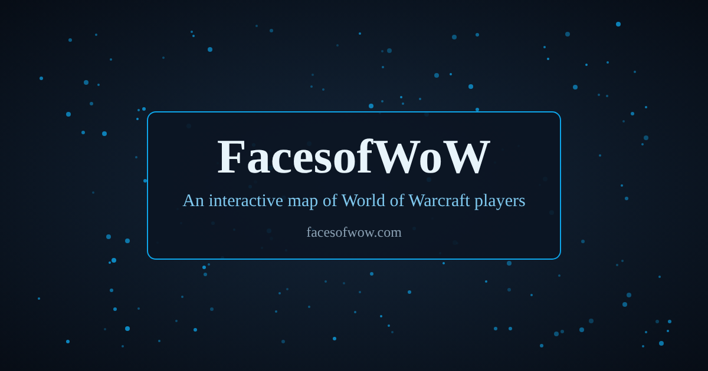

# FacesofWoW

An interactive map of World of Warcraft players. Players add themselves by city, and the map updates automatically.

**Live site:** https://facesofwow.com

> The source code for this project is private. This repo is a public write-up of what it is and how it was built.

## What it does

- Shows WoW players on an interactive globe and flat map (beta), which is the site's homepage
- Takes no-account submissions through a simple form, with privacy in mind (city-level only)
- Updates the map automatically, with no manual deploy step
- Includes other WoW projects on the same site:
  - **Raid Log:** a text-based idle MMORPG with a lockout timer, gear, and streak tracking
  - **Fact of the Day:** a daily WoW lore feature
  - **Expansion FAQ:** SEO-focused guides for the current expansion

## How it works

1. A player submits their character and location through a form.
2. The submission is sent in as structured JSON.
3. An hourly automation reads new submissions and updates the player data file (character names stay unique across the map).
4. The change is committed and published to Git through Composio.
5. The host redeploys, and the map shows the new players.

## Built with

- Plain HTML, CSS, and vanilla JavaScript (no frameworks)
- Leaflet for the map
- Web3Forms for submissions
- Claude Code for the build, plus agentic workflows for the hourly updates
- Composio for Git commits and publishing
- Sevalla for static hosting, with Cloudflare in front

## What this shows

- Shipping a real, live product end to end
- Wiring agentic automation into a production workflow
- Keeping the stack simple on purpose

## Contact

Martin, Austin, TX
LinkedIn: https://www.linkedin.com/in/martin-boogerd/
Email: martin@criticalwp.com

_Last updated: November 2026_
